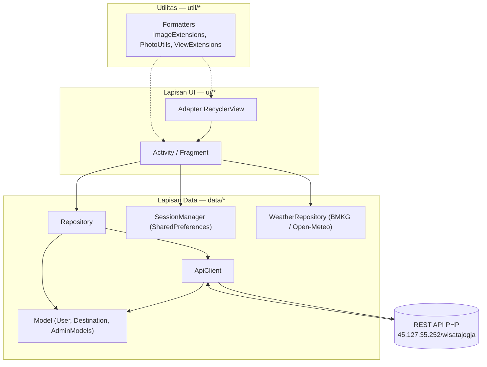

# Penjelasan Lengkap File Sumber Aplikasi WisataJogja

Dokumen ini menjelaskan satu per satu semua file Kotlin di:

```
app/src/main/java/com/example/wisatajogja/
```

Cocok dipakai sebagai bahan belajar dan contekan presentasi ke dosen.

---

## Gambaran Arsitektur

Aplikasi ini dipisah menjadi tiga lapisan:

- **`data/`** — urusan data: model, akses jaringan, repository, sesi login, cuaca.
- **`ui/`** — urusan tampilan: Activity, Fragment, Adapter, komponen custom.
- **`util/`** — fungsi bantu yang dipakai lintas layar: format, gambar, pesan.

Alur datanya:



Poin penting yang layak disebut ke dosen:

1. **Tidak memakai Retrofit/Room/ViewModel.** Semua request HTTP memakai `HttpURLConnection` bawaan Android + coroutine, dan state layar disimpan di Activity/Fragment. Ini pilihan desain yang membuat proyek ringan.
2. **Semua data utama berasal dari API** (login, destinasi, favorit, ulasan, reservasi, dashboard admin). Satu-satunya data lokal adalah sesi login dan preferensi notifikasi di `SharedPreferences`.
3. **Pola yang dipakai:** UI → Repository → ApiClient → API, lalu JSON dipetakan ke `data class` lewat `fromJson()`. Jadi Activity/Fragment tidak pernah menyentuh HTTP secara langsung.

---

## Folder Root

### `app/src/main/java/com/example/wisatajogja/WisataJogjaApplication.kt`

**Fungsi:** Kelas `Application` kustom yang menjadi titik start aplikasi (didaftarkan lewat `android:name=".WisataJogjaApplication"` di AndroidManifest). Di `onCreate()` ia mengunci tema ke mode terang (`MODE_NIGHT_NO`) dan memanggil `SessionManager.init(this)`.

**Tujuan:** Menyiapkan kebutuhan global sebelum layar pertama dibuka. `SessionManager` butuh `Context` untuk membuka `SharedPreferences`; kalau tidak diinisialisasi di sini, fitur cek sesi di `MainActivity`/`LoginActivity` bisa crash.

**Poin presentasi:** "Ini gerbang aplikasi; di sini tema dan sesi disiapkan sekali untuk seluruh proses."

---

## Folder `data/model` — Struktur Data

Folder ini berisi `data class` yang merepresentasikan JSON dari API. Semua punya `fromJson()` untuk mengubah `JSONObject` menjadi objek Kotlin yang type-safe.

### `app/src/main/java/com/example/wisatajogja/data/model/User.kt`

**Fungsi:** Mendefinisikan `User` (id, nama, username, email, telepon, domisili, bio, role, status, foto, statistik) dan `UserStats` (jumlah dikunjungi, tersimpan, ulasan). Ada `toJson()` untuk menyimpan user ke sesi, `fromJson()` untuk membacanya kembali, dan properti `isAdmin` (`role == "admin"`). Di file ini juga ada helper `JSONObject.stringOrNull()` untuk field teks yang boleh kosong/null.

**Tujuan:** Menjadi objek tunggal identitas pengguna yang dipakai di seluruh aplikasi — profil, sapaan beranda, pengecekan hak admin, dan data yang disimpan di `SessionManager`.

**Poin presentasi:** "Model User adalah sumber kebenaran untuk siapa yang sedang login; `isAdmin` menentukan apakah user diarahkan ke tampilan admin atau tampilan wisatawan."

### `app/src/main/java/com/example/wisatajogja/data/model/Destination.kt`

**Fungsi:** Berisi model inti aplikasi:
- `Destination` — data destinasi wisata lengkap (nama, slug, kategori, area, deskripsi, harga tiket, jam buka, rating, jumlah ulasan/dilihat, koordinat, status, unggulan, favorit, jumlah tersimpan).
- `GalleryItem` — foto galeri.
- `DestinationService` — layanan di destinasi (jeep, homestay, pemandu, dll.), dengan `isCommunity` untuk membedakan layanan komunitas.
- `Review` dan `MyReview` — ulasan pengguna lain dan ulasan milik user yang login.
- `Reservation` — data reservasi/booking.

`Destination.fromJson()` mem-parse semua array bersarang (galeri, layanan, ulasan, `mirip` yang rekursif). `Reservation.fromJson()` memetakan riwayat reservasi.

**Tujuan:** Satu model untuk semua layar: beranda, eksplorasi, tersimpan, detail, form admin, dan riwayat reservasi. Tanpa file ini, setiap layar harus mem-parsing JSON sendiri dan rawan salah tipe.

**Poin presentasi:** "Destination adalah model terbesar karena halaman detail membutuhkan data bersarang: galeri, layanan, ulasan, destinasi mirip. Semua pemetaan JSON terpusat di sini."

### `app/src/main/java/com/example/wisatajogja/data/model/AdminModels.kt`

**Fungsi:** Model khusus dashboard admin:
- `AdminMetrics` — total kunjungan 30 hari, persentase perubahan, total pengguna/baru, total destinasi/terbit/draf, total tersimpan, ulasan, rating rata-rata, reservasi.
- `ChartPoint` — titik grafik kunjungan (tanggal, label, jumlah).
- `AdminUser` + `AdminUserPage` — data pengguna untuk tabel admin (termasuk jumlah tersimpan/reservasi) dan hasil paginasi.
- `PopularDestination`, `RecentReservation`, `AdminSummary` — ringkasan dashboard lengkap dengan `fromJson()`.

**Tujuan:** Memisahkan data khusus admin dari model wisatawan. `AdminSummary` memungkinkan satu request mengisi seluruh dashboard (metrik, grafik, pengguna terbaru, destinasi populer, reservasi terbaru).

**Poin presentasi:** "Satu endpoint ringkasan mengembalikan banyak bagian dashboard; `AdminSummary.fromJson` memecahnya menjadi objek-objek kecil agar mudah ditampilkan."

---

## Folder `data/remote` — Komunikasi Jaringan

### `app/src/main/java/com/example/wisatajogja/data/remote/ApiClient.kt`

**Fungsi:** Satu-satunya kelas yang berkomunikasi dengan server. Berisi:
- `BASE_URL` → `https://45.127.35.252/wisatajogja/api/index.php`.
- `get(action, params, token)` — request GET dengan query `?action=...`.
- `post(action, body, token)` — request POST berisi JSON.
- `upload(action, file, fieldName, fields, token)` — upload multipart manual (boundary, header `Content-Disposition`) untuk foto profil/gambar destinasi.
- `execute()` — menjalankan request di `Dispatchers.IO`, memasang timeout, header `Authorization: Bearer <token>`, lalu memanggil `parse()`.
- `parse()` — membaca respons, menganggap sukses hanya jika HTTP 2xx **dan** JSON `success == true`; jika gagal melempar `ApiException` dengan pesan server atau pesan fallback (401 = sesi berakhir, 403 = tidak punya akses, 404 = data tidak ditemukan).
- Menangkap `SocketTimeoutException`/`UnknownHostException` menjadi pesan Indonesia yang ramah.

**Tujuan:** Menjadi "pintu tunggal" ke backend. Repository cukup memanggil `ApiClient.get/post/upload`, tanpa tahu detail HTTP, encoding, token, atau error handling. Ini memudahkan penggantian backend di masa depan.

**Poin presentasi:** "Semua request lewat ApiClient supaya penanganan token, timeout, dan error konsisten di seluruh aplikasi."

### `app/src/main/java/com/example/wisatajogja/data/remote/ApiException.kt`

**Fungsi:** Kelas exception kustom yang membawa `message` dan `statusCode`.

**Tujuan:** Membedakan error API (mis. "Email sudah terdaftar", "Sesi berakhir") dari error teknis lain, sehingga UI bisa menampilkan pesan yang tepat ke pengguna.

---

## Folder `data/repository` — Logika Akses Data

Repository adalah perantara antara UI dan `ApiClient`. UI memanggil fungsi bernama jelas (`login`, `explore`, `toggleFavorite`), bukan menyusun request mentah.

### `app/src/main/java/com/example/wisatajogja/data/repository/AuthRepository.kt`

**Fungsi:** Menangani autentikasi:
- `login(email, password)` → `AuthResult(token, user)`.
- `register(name, email, password)` → otomatis dapat token + user.
- `forgotPassword(email)` → mengembalikan `resetCode` bila server menyediakannya.
- `resetPassword(email, code, password)` → pesan sukses.
- `refreshCurrentUser()` → memanggil endpoint `me` untuk menyegarkan data profil.
- `logout()` → memanggil API logout, lalu **selalu** menghapus sesi lokal (`SessionManager.clear()`), meskipun request gagal.
- `initializeSession()` — helper untuk menyimpan sesi di main thread.

**Tujuan:** Memusatkan aturan autentikasi: memanggil endpoint yang benar, memetakan respons menjadi `User`, dan menjaga sesi tetap sinkron.

**Poin presentasi:** "AuthRepository adalah satu-satunya tempat yang tahu urutan login/register/logout beserta penyimpanan sesinya."

### `app/src/main/java/com/example/wisatajogja/data/repository/DestinationRepository.kt`

**Fungsi:** Semua operasi destinasi untuk sisi wisatawan:
- `explore(category, query, area, featuredOnly, limit)` — daftar destinasi dengan filter.
- `detail(id/slug)` — detail satu destinasi.
- `savedDestinations()` — daftar favorit user.
- `toggleFavorite(id)` — tambah/hapus favorit, mengembalikan status baru.
- `submitReview(id, rating, comment)` — kirim ulasan.
- `areas()` — daftar area + jumlah destinasi untuk chip di beranda.
- Helper privat `JSONArray.toDestinations()` untuk konversi array JSON.

**Tujuan:** Menyediakan API data yang siap dipakai layar beranda, eksplorasi, tersimpan, dan detail, termasuk filter dan pencarian.

**Poin presentasi:** "Endpoint `destinasi` dipakai berulang dengan parameter berbeda; repository inilah yang merakit parameter kategori/area/pencarian."

### `app/src/main/java/com/example/wisatajogja/data/repository/ProfileRepository.kt`

**Fungsi:** Berisi dua kelas:
- `ProfileRepository` — `updateProfile()` (nama, username, telepon, domisili, bio), `uploadPhoto()` (multipart, lalu memperbarui `SessionManager`), `changePassword()`, dan `reservations()` (riwayat booking).
- `ReservationRepository` — `create()` untuk membuat reservasi baru (destinasi, tanggal, jumlah orang, catatan).

**Tujuan:** Menangani data profil dan reservasi milik user. Setiap perubahan profil langsung disinkronkan ke sesi lokal agar UI lain ikut terbarui.

**Poin presentasi:** "Dua repository dalam satu file karena keduanya mengelola data akun pengguna: profil dan reservasinya."

### `app/src/main/java/com/example/wisatajogja/data/repository/AdminRepository.kt`

**Fungsi:** Operasi khusus admin:
- `summary()` — dashboard ringkasan.
- `users(query, status, page)` — daftar pengguna dengan pencarian, filter status, dan paginasi.
- `updateUserStatus(id, status)` — aktif/nonaktifkan pengguna.
- `destinations(query, status)` — daftar semua destinasi termasuk draf.
- `uploadDestinationImage(file)` — upload gambar destinasi.
- `saveDestination(form)` — buat baru atau update (jika `id > 0`).
- `deleteDestination(id)` — hapus destinasi.
- `DestinationForm` — objek pembawa data form destinasi.

**Tujuan:** Memisahkan akses endpoint admin dari sisi wisatawan, sekaligus menyatukan logika create/update destinasi dalam satu metode `saveDestination`.

**Poin presentasi:** "Admin punya repository sendiri karena endpoint dan hak aksesnya berbeda; `DestinationForm` membuat form tidak perlu mengirim JSON mentah."

---

## Folder `data/session` — Sesi Login

### `app/src/main/java/com/example/wisatajogja/data/session/SessionManager.kt`

**Fungsi:** `object` singleton berbasis `SharedPreferences` dengan nama `wisata_jogja_session`. Menyimpan:
- `token` — token Bearer API.
- `currentUser` — objek `User` yang diserialisasi ke JSON.
- `isGuest` — mode tamu (boleh melihat tanpa login).
- `notificationsEnabled` — preferensi switch notifikasi.
- Turunan: `isLoggedIn`, `isAdmin`.
- Fungsi: `init()`, `saveSession()`, `updateUser()`, `enterGuestMode()`, `clear()`.

**Tujuan:** Menjaga status login antar-layar dan antar-sesi aplikasi. `MainActivity` memakainya untuk menolak akses tanpa login, `LoginActivity` untuk redirect otomatis, dan `ProfilFragment` untuk menampilkan data user tanpa request ulang.

**Poin presentasi:** "SessionManager adalah penyimpanan sesi lokal; token dipakai ApiClient sebagai header Authorization, sedangkan data user dipakai UI. Catatan: untuk produksi, token sebaiknya disimpan di EncryptedSharedPreferences."

---

## Folder `data/weather` — Cuaca

### `app/src/main/java/com/example/wisatajogja/data/weather/Weather.kt`

**Fungsi:** `data class Weather` berisi suhu, deskripsi, kelembapan, kecepatan angin, UV index, sumber (BMKG/Open-Meteo), dan waktu update.

**Tujuan:** Struktur data cuaca yang seragam meskipun sumbernya berbeda.

### `app/src/main/java/com/example/wisatajogja/data/weather/WeatherRepository.kt`

**Fungsi:**
- `load(force)` dengan cache 15 menit; `force = true` dipakai saat pull-to-refresh.
- `fetchBmkg()` — mengambil prakiraan BMKG untuk kode wilayah `34.71.01.1001` (Kota Yogyakarta), memilih prakiraan yang paling dekat dengan waktu sekarang.
- `fetchOpenMeteo()` — sumber cadangan sekaligus penyedia UV index.
- Strategi: BMKG diutamakan; kalau gagal, pakai Open-Meteo; kalau keduanya gagal, lempar error.
- `descriptionForCode()` — menerjemahkan kode cuaca Open-Meteo ke teks Indonesia.

**Tujuan:** Menampilkan cuaca Yogyakarta di halaman login dan beranda, dengan fallback agar fitur tidak mati saat satu penyedia bermasalah.

**Poin presentasi:** "Ada dua API cuaca: BMKG sebagai sumber utama, Open-Meteo sebagai cadangan dan pemasok UV index. Cache 15 menit mencegah request berulang."

---

## Folder `ui/base` — Dasar Activity

### `app/src/main/java/com/example/wisatajogja/ui/base/BaseActivity.kt`

**Fungsi:** Induk semua Activity. Melakukan tiga hal:
1. `attachBaseContext()` — memaksa locale `id-ID` agar format tanggal/angka konsisten Bahasa Indonesia.
2. `onCreate()` — mengaktifkan edge-to-edge (konten sampai ke status/navigation bar) dengan gaya terang.
3. `applyInsets(root)` — menambahkan padding sesuai ukuran status bar, navigation bar, dan keyboard (IME), sehingga konten tidak tertutup.

**Tujuan:** Menghindari duplikasi kode pengaturan bahasa, tampilan penuh, dan inset di 15+ Activity. Semua layar otomatis konsisten.

**Poin presentasi:** "BaseActivity memusatkan urusan tampilan sistem; Activity turunan cukup memanggil `applyInsets`."

---

## Folder `ui/navigation` — Navigasi

### `app/src/main/java/com/example/wisatajogja/ui/navigation/MainNavigator.kt`

**Fungsi:** Mengatur navigasi empat tab utama wisatawan lewat enum `MainTab`: BERANDA, EKSPLORASI (Rekomendasi), TERSIMPAN, PROFIL. Mengganti Fragment dengan `FragmentManager.replace()`, memberi animasi fade, dan menghubungkan bottom navigation. `navigateToExplore(category, area)` membuka tab eksplorasi dengan filter awal. `restoreTab()` memulihkan tab setelah rotasi/proses dimatikan.

**Tujuan:** Memisahkan logika perpindahan tab dari `MainActivity`, sehingga Activity tetap ringkas dan navigasi mudah diubah.

### `app/src/main/java/com/example/wisatajogja/ui/navigation/AdminNavigator.kt`

**Fungsi:** Versi admin dari navigator, dengan enum `AdminTab`: RINGKASAN, KELOLA WISATA, PENGGUNA, AKUN. Struktur dan cara kerjanya sama seperti `MainNavigator`, tetapi memakai fragment admin dan warna bottom nav khusus admin (aksen emas).

**Tujuan:** Navigasi panel admin terpisah total dari navigasi wisatawan.

### `app/src/main/java/com/example/wisatajogja/ui/navigation/BottomNavController.kt`

**Fungsi:** Pengendali bottom navigation kustom (bukan `BottomNavigationView` bawaan). Menyimpan daftar `BottomNavItem`, memasang listener klik, dan `select(index)` mengatur:
- background aktif/nonaktif,
- lebar item aktif (weight 1.65 vs 1),
- warna icon dan label,
- ketebalan font label aktif.

**Tujuan:** Membuat bottom nav bergaya "pil" yang tidak bisa dicapai dengan komponen standar, tanpa menduplikasi logika di dua navigator.

**Poin presentasi:** "Bottom nav sengaja dibuat custom supaya item aktif membesar seperti pil; satu controller dipakai bersama oleh navigator wisatawan dan admin."

---

## Folder `ui/auth` — Login dan Akun

### `app/src/main/java/com/example/wisatajogja/ui/auth/LoginActivity.kt`

**Fungsi:** Layar masuk sekaligus launcher aplikasi.
- Jika sudah login → langsung diarahkan ke `AdminMainActivity` (admin) atau `MainActivity`.
- Jika mode tamu dan dibuka sebagai launcher → langsung ke beranda.
- Validasi email (`@`, panjang ≥ 6) dan password (≥ 6).
- Memanggil `AuthRepository.login`, menyimpan sesi, lalu mengarahkan sesuai role.
- Tombol "Masuk sebagai tamu" memanggil `SessionManager.enterGuestMode()`.
- Memuat gambar hero dan cuaca untuk mempercantik layar login.

**Tujuan:** Menjadi pintu masuk tunggal yang menentukan tujuan pengguna berdasarkan status login dan role.

**Poin presentasi:** "Login bukan sekadar form; ia adalah router awal aplikasi: admin, wisatawan, tamu, atau sudah login."

### `app/src/main/java/com/example/wisatajogja/ui/auth/RegisterActivity.kt`

**Fungsi:** Form pendaftaran: nama (≥ 3), email valid, password (≥ 6), konfirmasi password harus sama, dan checkbox syarat wajib dicentang. Setelah `register` berhasil, sesi langsung disimpan dan user diarahkan ke `MainActivity` (auto-login).

**Tujuan:** Membuat akun baru tanpa harus login ulang setelah mendaftar.

### `app/src/main/java/com/example/wisatajogja/ui/auth/ForgotPasswordActivity.kt`

**Fungsi:** Meminta kode pemulihan berdasarkan email. Jika API mengembalikan `reset_code`, kode ditampilkan lewat dialog (mode demo/pengembangan) dan tombol lanjut membawa email + kode ke `ResetPasswordActivity`. Jika tidak, ditampilkan pesan netral "jika email terdaftar...".

**Tujuan:** Menyediakan alur lupa password yang aman secara pesan (tidak membocorkan apakah email terdaftar) namun tetap bisa didemokan.

### `app/src/main/java/com/example/wisatajogja/ui/auth/ResetPasswordActivity.kt`

**Fungsi:** Form reset password: kode 6 digit, password baru ≥ 6, dan konfirmasi. Setelah berhasil, user diarahkan kembali ke `LoginActivity` dengan flag `CLEAR_TASK`.

**Tujuan:** Menyelesaikan pemulihan akun dan memastikan pengguna masuk lewat jalur login yang bersih.

---

## Folder `ui/main` — Tampilan Utama Wisatawan

### `app/src/main/java/com/example/wisatajogja/ui/main/MainActivity.kt`

**Fungsi:** Host empat tab wisatawan. Saat dibuka:
- menolak akses jika belum login dan bukan tamu → lempar ke `LoginActivity`;
- menyiapkan `MainNavigator`, bottom navigation, dan container Fragment;
- menyimpan tab terakhir di `onSaveInstanceState`;
- menyediakan `openExplore(category, area)` agar Fragment lain bisa berpindah tab dengan filter.

**Tujuan:** Menjadi "kerangka" aplikasi wisatawan; semua konten tab hidup di dalamnya tanpa Activity baru.

### `app/src/main/java/com/example/wisatajogja/ui/main/beranda/BerandaFragment.kt`

**Fungsi:** Halaman utama wisatawan:
- sapaan sesuai jam (`seniorGreeting`), nama depan user/tamu, dan tanggal;
- widget cuaca lengkap (suhu, deskripsi, angin, kelembapan, UV, sumber, jam update) dengan ikon dinamis;
- daftar destinasi unggulan (horizontal) dan rekomendasi (vertikal);
- chip area dari API (fallback ke lima kabupaten/kota bila gagal) yang membuka tab eksplorasi terfilter;
- pull-to-refresh memuat ulang data dan cuaca;
- tombol favorit (menolak jika belum login → ke Login);
- dialog notifikasi dan komunitas.

**Tujuan:** Memberi ringkasan cepat kondisi wisata dan cuaca, serta jalan pintas ke eksplorasi. Ini layar pertama yang dilihat wisatawan.

**Poin presentasi:** "Beranda memuat tiga data paralel sekaligus memakai `async`: unggulan, semua destinasi, dan daftar area."

### `app/src/main/java/com/example/wisatajogja/ui/main/beranda/BerandaDestinationAdapter.kt`

**Fungsi:** Adapter kartu destinasi ukuran ringkas untuk daftar horizontal unggulan. Menampilkan kategori, nama, area, rating + jumlah ulasan, gambar, dan tombol favorit.

**Tujuan:** Menjaga tampilan kartu unggulan konsisten dan reusable.

### `app/src/main/java/com/example/wisatajogja/ui/main/beranda/WideDestinationAdapter.kt`

**Fungsi:** Adapter kartu lebar untuk daftar rekomendasi vertikal. Menampilkan harga tiket, rating, gambar, dan tombol favorit.

**Tujuan:** Format kartu berbeda untuk konteks berbeda (unggulan horizontal vs rekomendasi vertikal), tanpa menggabungkan dua layout dalam satu adapter.

### `app/src/main/java/com/example/wisatajogja/ui/main/rekomendasi/RekomendasiFragment.kt`

**Fungsi:** Halaman eksplorasi:
- grid 2 kolom destinasi;
- filter kategori lewat chip (Semua/Pantai/Budaya/Alam);
- pencarian dengan debounce 350 ms agar tidak request setiap ketikan;
- filter area yang dikirim dari beranda lewat `newInstance(category, area)`;
- pull-to-refresh dan tombol favorit.

**Tujuan:** Menjadi katalog pencarian destinasi. Debounce dan filter server-side menjaga beban API tetap wajar.

**Poin presentasi:** "`newInstance` mengirim filter lewat `arguments` Bundle, sehingga state Fragment tidak hilang saat proses dipulihkan."

### `app/src/main/java/com/example/wisatajogja/ui/main/rekomendasi/ExploreAdapter.kt`

**Fungsi:** Adapter item grid eksplorasi: kategori, nama, area, rating + jumlah ulasan, harga, gambar, favorit.

**Tujuan:** Tampilan katalog yang padat dua kolom.

### `app/src/main/java/com/example/wisatajogja/ui/main/tersimpan/TersimpanFragment.kt`

**Fungsi:** Halaman favorit:
- jika belum login → tampilkan keadaan tamu dan tombol login;
- memuat `savedDestinations()`;
- menghapus item dari daftar lewat `toggleFavorite`;
- pull-to-refresh dan empty state.

**Tujuan:** Memberi user daftar rencana perjalanan yang tersimpan, serta mengarahkan tamu untuk login agar fitur ini berguna.

### `app/src/main/java/com/example/wisatajogja/ui/main/tersimpan/SavedAdapter.kt`

**Fungsi:** Adapter daftar tersimpan: kategori, nama, area + jam buka, rating, gambar, dan tombol hapus.

**Tujuan:** Tampilan daftar favorit yang menonjolkan informasi ringkas dan aksi cepat.

### `app/src/main/java/com/example/wisatajogja/ui/main/profil/ProfilFragment.kt`

**Fungsi:** Halaman profil wisatawan:
- menampilkan nama, email, statistik (dikunjungi/tersimpan/ulasan), avatar;
- keadaan tamu menyembunyikan menu akun dan menampilkan tombol login;
- ganti foto: pilih kamera/galeri/file → crop 1:1 → upload;
- menu edit profil, ubah sandi, reservasi saya, bantuan (email), kebijakan privasi, panel admin (jika admin), logout dengan konfirmasi;
- switch notifikasi disimpan lokal;
- `refreshUser()` menyegarkan data dari endpoint `me` setiap layar aktif.

**Tujuan:** Pusat pengaturan akun wisatawan. Semua aksi akun dikumpulkan di satu layar.

**Poin presentasi:** "Profil membaca data dari sesi dulu agar tampil instan, lalu menyegarkannya dari API di belakang."

---

## Folder `ui/detail` — Detail Destinasi & Ulasan

### `app/src/main/java/com/example/wisatajogja/ui/detail/DetailWisataActivity.kt`

**Fungsi:** Layar detail destinasi:
- memuat detail berdasarkan ID;
- menampilkan hero image, kategori, nama, area, deskripsi, rating, jumlah ulasan, harga, jam buka, koordinat;
- galeri horizontal (dengan dialog perbesar), layanan horizontal, dan daftar ulasan;
- peta: embed interaktif OpenStreetMap di `WebView` pada koordinat destinasi, lengkap dengan marker dan atribusi OSM;
- tombol favorit, share (teks + link Google Maps), buka aplikasi peta;
- tombol tulis/edit ulasan (memakai `registerForActivityResult` agar detail otomatis refresh setelah ulasan dikirim);
- tombol reservasi;
- state loading, error + tombol retry;
- membersihkan `WebView` di `onDestroy` untuk mencegah memory leak.

**Tujuan:** Menjadi halaman informasi terlengkap dan pusat aksi (simpan, bagikan, ulasan, reservasi) sebelum user memesan.

**Poin presentasi:** "Detail memakai WebView untuk embed peta interaktif OpenStreetMap; tidak perlu Google Maps SDK dan tidak memakai gambar peta statis."

### `app/src/main/java/com/example/wisatajogja/ui/detail/TulisUlasanActivity.kt`

**Fungsi:** Form tulis/edit ulasan: rating bar 1–5 dengan label, komentar minimal 5 karakter, kirim ke API. Bila dibuka untuk ulasan yang sudah ada, form terisi rating/komentar lama. Sukses → `RESULT_OK` dan layar detail memuat ulang.

**Tujuan:** Memisahkan proses menulis ulasan dari detail agar fokus dan mudah dipakai ulang.

### `app/src/main/java/com/example/wisatajogja/ui/detail/DetailAdapters.kt`

**Fungsi:** Tiga adapter dalam satu file:
- `GalleryAdapter` — foto galeri horizontal, klik untuk memperbesar.
- `ServiceAdapter` — kartu layanan dengan ikon berdasarkan kode (`jeep`, `food`, `homestay`, dll.), badge jenis layanan, harga per grup.
- `ReviewAdapter` — ulasan dengan avatar atau inisial, komentar, tanggal, dan bintang teks (★/☆).

**Tujuan:** Mengelompokkan adapter yang hanya dipakai halaman detail, sehingga folder detail tetap ringkas.

---

## Folder `ui/profile` — Edit Akun

### `app/src/main/java/com/example/wisatajogja/ui/profile/EditProfilActivity.kt`

**Fungsi:** Form edit profil: nama, username, email (read-only), telepon, domisili, bio, avatar. Validasi nama ≥ 3 dan username 3–30 karakter `[a-z0-9._]`. Foto memakai alur pilih → crop 1:1 → upload. Menyimpan lewat `ProfileRepository.updateProfile` yang juga memperbarui sesi.

**Tujuan:** Memungkinkan user mengubah data profil dan foto dalam satu layar.

### `app/src/main/java/com/example/wisatajogja/ui/profile/UbahSandiActivity.kt`

**Fungsi:** Form ubah kata sandi: sandi lama, sandi baru (≥ 6), konfirmasi harus sama. Memanggil `ProfileRepository.changePassword`.

**Tujuan:** Menyediakan perubahan password yang terverifikasi sandi lama, terpisah dari edit profil.

---

## Folder `ui/reservasi` — Reservasi

### `app/src/main/java/com/example/wisatajogja/ui/reservasi/ReservasiActivity.kt`

**Fungsi:** Form booking:
- menampilkan destinasi, area, harga tiket/orang, gambar;
- pemilih tanggal `MaterialDatePicker` dengan zona waktu `Asia/Jakarta`;
- jumlah orang 1–10 (tombol −/+, alpha tombol saat batas);
- ringkasan total otomatis (harga × orang);
- catatan opsional;
- validasi tanggal tidak boleh masa lalu;
- setelah sukses, dialog menampilkan kode booking;
- jumlah orang dan tanggal disimpan di `onSaveInstanceState` agar tidak hilang saat rotasi.

**Tujuan:** Menyelesaikan alur pemesanan dengan perhitungan total dan konfirmasi kode booking.

**Poin presentasi:** "Perhitungan total dilakukan lokal untuk tampilan, tetapi nilai final tetap divalidasi server saat `reservasi-buat`."

### `app/src/main/java/com/example/wisatajogja/ui/reservasi/ReservasiSayaActivity.kt`

**Fungsi:** Daftar riwayat reservasi user, dengan ringkasan jumlah total dan jumlah reservasi mendatang (status `menunggu`/`dikonfirmasi`), pull-to-refresh, empty state, dan tombol kembali. Menolak akses jika belum login.

**Tujuan:** Memberi user riwayat dan status booking-nya.

### `app/src/main/java/com/example/wisatajogja/ui/reservasi/ReservationHistoryAdapter.kt`

**Fungsi:** Adapter kartu reservasi: kode booking, destinasi, area, tanggal (format Indonesia), jumlah orang, total harga, catatan, dan badge status berwarna (menunggu, dikonfirmasi, selesai, dibatalkan).

**Tujuan:** Menampilkan status booking secara visual cepat dikenali.

---

## Folder `ui/common` — Komponen Bersama

### `app/src/main/java/com/example/wisatajogja/ui/common/SansTextView.kt`

**Fungsi:** `TextView` kustom yang memakai font Inter (`inter_regular`) lewat `ResourcesCompat`.

**Tujuan:** Memastikan tipografi sans-serif konsisten di semua versi/build Android, karena `android:fontFamily` di XML tidak selalu sama hasilnya.

### `app/src/main/java/com/example/wisatajogja/ui/common/SerifTextView.kt`

**Fungsi:** `TextView` kustom dengan font Playfair Display SemiBold untuk heading.

**Tujuan:** Memberi identitas visual (heading elegan) yang stabil lintas perangkat.

### `app/src/main/java/com/example/wisatajogja/ui/common/DestinationDiff.kt`

**Fungsi:** `DiffUtil.ItemCallback<Destination>`: item dianggap sama jika `id` sama, dan konten sama jika objek `Destination` sama (data class).

**Tujuan:** Dipakai semua `ListAdapter` destinasi agar RecyclerView hanya menggambar ulang item yang berubah, bukan seluruh daftar.

### `app/src/main/java/com/example/wisatajogja/ui/common/PhotoPickerDelegate.kt`

**Fungsi:** Pembantu pemilihan foto yang mendaftarkan empat `ActivityResultContract`:
- `PickVisualMedia` — galeri foto modern;
- `OpenDocument` — file manager;
- `TakePicture` — kamera;
- `RequestPermission` — izin kamera.

Juga menampilkan dialog sumber (kamera/galeri/file), membuat file sementara kamera lewat `PhotoUtils`, dan melaporkan error lewat callback.

**Tujuan:** Menghindari duplikasi kode pemilihan foto di `ProfilFragment`, `EditProfilActivity`, dan `FormWisataActivity`.

**Poin presentasi:** "Delegate ini membungkus Activity Result API; pemanggil cukup memberi callback `onPicked`."

### `app/src/main/java/com/example/wisatajogja/ui/common/CropImageActivity.kt`

**Fungsi:** Layar editor crop:
- menerima URI sumber dan rasio aspek (1:1 profil, 16:9 destinasi);
- memuat bitmap berorientasi benar dengan batas 2400 px;
- tombol zoom in/out, simpan, batal;
- menyimpan hasil crop ke file cache dan mengembalikan path lewat `EXTRA_OUTPUT_PATH`;
- menampilkan state progress dan error.

**Tujuan:** Menyeragamkan ukuran/rasio gambar sebelum upload, sehingga server menerima file yang rapi dan hemat bandwidth.

### `app/src/main/java/com/example/wisatajogja/ui/common/CropImageView.kt`

**Fungsi:** `View` kustom untuk crop:
- menampilkan bitmap dengan `Matrix`;
- mendukung geser (drag) dan cubit (pinch zoom) dengan `ScaleGestureDetector`;
- membatasi skala min/max dan posisi agar gambar selalu menutupi frame crop;
- menggambar overlay gelap, border, grid tiga bagian, dan handle sudut;
- `createCroppedFile()` merender hasil ke bitmap, memotong sesuai frame, menyesuaikan ukuran output (1280 untuk landscape, 1080 untuk lainnya), dan mengompres JPEG kualitas 90;
- `release()` mendaur ulang bitmap.

**Tujuan:** Menyediakan editor crop mandiri tanpa library pihak ketiga, sekaligus mengontrol kualitas dan ukuran hasil.

**Poin presentasi:** "Semua matematika transformasi gambar ada di view ini; Activity hanya mengatur alur dan menyimpan file."

---

## Folder `ui/admin` — Panel Admin

### `app/src/main/java/com/example/wisatajogja/ui/admin/AdminMainActivity.kt`

**Fungsi:** Host empat tab admin. Saat dibuka, memeriksa `SessionManager.isAdmin`; jika bukan admin → ke `LoginActivity` dengan `CLEAR_TASK`. Menyiapkan `AdminNavigator`, bottom nav, penyimpanan tab terakhir, dan `openTab()` untuk pindah tab dari Fragment lain.

**Tujuan:** Mencegah akses tidak sah ke panel admin sekaligus menjadi kerangka navigasi admin.

### `app/src/main/java/com/example/wisatajogja/ui/admin/ringkasan/RingkasanFragment.kt`

**Fungsi:** Dashboard admin:
- sapaan admin, tanggal, inisial avatar;
- empat kartu metrik: kunjungan 30 hari (+persentase), total pengguna (+baru), destinasi terbit (dari total + draf), total tersimpan (+ulasan & reservasi);
- grafik batang tren kunjungan;
- daftar destinasi populer, pengguna terbaru, reservasi terbaru;
- tombol pintas ke tab Kelola Wisata/Pengguna;
- pull-to-refresh, loading, error + retry.

**Tujuan:** Memberi admin gambaran kondisi aplikasi dalam satu layar.

### `app/src/main/java/com/example/wisatajogja/ui/admin/ringkasan/SummaryAdapters.kt`

**Fungsi:** Tiga adapter untuk dashboard (`PopularDestinationAdapter`, `RecentUsersAdapter`, `RecentReservationsAdapter`) plus helper `NumberFormatCompact`.

**Tujuan:** Menampilkan tiga daftar ringkas dengan format berbeda tanpa membuat file terpisah untuk masing-masing.

### `app/src/main/java/com/example/wisatajogja/ui/admin/ringkasan/BarChartView.kt`

**Fungsi:** `View` kustom penggambar grafik batang:
- grid horizontal, batang hijau, batang terakhir disorot emas;
- label tanggal selektif agar tidak bertumpuk;
- animasi pertumbuhan batang dengan `ValueAnimator` 620 ms;
- animasi dihentikan saat view dilepas.

**Tujuan:** Menampilkan tren kunjungan tanpa library chart eksternal.

### `app/src/main/java/com/example/wisatajogja/ui/admin/wisata/KelolaWisataFragment.kt`

**Fungsi:** Daftar seluruh destinasi untuk admin:
- pencarian lokal berdasarkan nama/area (langsung memfilter `allDestinations`);
- filter chip status: Semua/Terbit/Draf;
- ringkasan jumlah total/terbit/draf;
- tombol tambah → `FormWisataActivity`;
- klik item → edit;
- hapus dengan dialog konfirmasi;
- refresh otomatis saat kembali dari form.

**Tujuan:** Menjadi pusat CRUD katalog wisata.

### `app/src/main/java/com/example/wisatajogja/ui/admin/wisata/AdminDestinationAdapter.kt`

**Fungsi:** Adapter baris destinasi admin: nama, kategori/area/jam buka, jumlah tersimpan, badge status Terbit/Draf, gambar, tombol edit dan hapus.

**Tujuan:** Menampilkan data operasional (status dan popularitas) yang tidak perlu dilihat wisatawan.

### `app/src/main/java/com/example/wisatajogja/ui/admin/wisata/FormWisataActivity.kt`

**Fungsi:** Form tambah/edit destinasi:
- dropdown kategori (Pantai/Budaya/Alam) dengan `ArrayAdapter`;
- field nama, area, deskripsi singkat, deskripsi, harga, jam buka, latitude, longitude, switch terbit, switch unggulan;
- unggah gambar: pilih → crop 16:9 → upload → URL otomatis terisi;
- validasi lengkap (nama ≥ 3, kategori valid, field wajib, koordinat angka, gambar wajib);
- mode tambah punya nilai default (kategori Alam, harga 0, jam 07.00–17.00, koordinat Yogyakarta, status draf);
- simpan lewat `AdminRepository.saveDestination`.

**Tujuan:** Menyatukan create dan update destinasi dalam satu layar dan satu repository method.

**Poin presentasi:** "Form yang sama dipakai untuk tambah dan edit; perbedaannya hanya `destinationId` — jika > 0, repository mengirim `id` dan data lama dimuat."

### `app/src/main/java/com/example/wisatajogja/ui/admin/pengguna/PenggunaFragment.kt`

**Fungsi:** Daftar pengguna dengan:
- pencarian debounce 400 ms;
- filter status Aktif/Nonaktif;
- paginasi ("infinite scroll"): memuat halaman berikutnya saat user mendekati item terakhir;
- menampilkan total pengguna;
- aksi per pengguna: aktifkan/nonaktifkan lewat dialog;
- akun admin tidak bisa dinonaktifkan dari layar ini (dialog penjelasan).

**Tujuan:** Memberi admin kendali moderasi akun tanpa membebani loading di awal.

**Poin presentasi:** "Paginasi memakai asumsi 20 item per halaman; `hasMore = halaman × 20 < total`."

### `app/src/main/java/com/example/wisatajogja/ui/admin/pengguna/AdminUserAdapter.kt`

**Fungsi:** Adapter baris pengguna: inisial, nama, email, label ADMIN/WISATAWAN, status aktif/nonaktif, jumlah tersimpan dan reservasi, tombol menu. Memiliki `submit()` untuk reset dan `append()` untuk menambah halaman berikutnya.

**Tujuan:** Mendukung daftar yang bertambah tanpa menggambar ulang seluruh isi.

### `app/src/main/java/com/example/wisatajogja/ui/admin/akun/AkunAdminFragment.kt`

**Fungsi:** Profil admin: avatar/inisial, nama, email, menu edit profil, ubah sandi, buka tampilan wisatawan (`MainActivity`), bantuan penggunaan panel, dan logout dengan konfirmasi. Menyegarkan data admin dari endpoint `me`.

**Tujuan:** Menyediakan pengaturan akun admin dan jalan pintas untuk melihat aplikasi dari sisi wisatawan.

---

## Folder `util` — Fungsi Bantu

### `app/src/main/java/com/example/wisatajogja/util/Formatters.kt`

**Fungsi:** Format tampilan Bahasa Indonesia:
- `formatNumber` — pemisah ribuan;
- `formatRupiah` — "Gratis" atau "Rp...";
- `formatRating` — satu desimal;
- `formatTemperature` — "30°";
- `seniorGreeting` — pagi/siang/sore/malam berdasarkan jam;
- `formatVisitDate` / `formatDateShort` — format tanggal Indonesia;
- `monthYearNow` / `todayLabel` — label bulan dan hari.

**Tujuan:** Menjamin format angka/tanggal konsisten dan tidak diduplikasi di setiap layar.

### `app/src/main/java/com/example/wisatajogja/util/ImageExtensions.kt`

**Fungsi:** Ekstensi `ImageView`:
- `loadPhoto(url, circular)` — Glide dengan placeholder, error image, cache otomatis, crossfade 220 ms, crop tengah;
- `loadAvatar(url)` — varian lingkaran dengan placeholder avatar.

**Tujuan:** Memusatkan konfigurasi pemuatan gambar. Semua layar cukup memanggil `image.loadPhoto(url)`.

### `app/src/main/java/com/example/wisatajogja/util/PhotoUtils.kt`

**Fungsi:** Utilitas file gambar:
- `createCameraFile()` — file sementara di cache;
- `uriForFile()` — URI aman lewat `FileProvider`;
- `loadOrientedBitmap()` — membaca bitmap dengan orientasi EXIF dan subsampling;
- `compressToJpeg()` — decode → rotasi → skala maksimal 1440 px → JPEG kualitas 88;
- `rotateIfNeeded()` — menangani rotasi/flip EXIF.

**Tujuan:** Mencegah foto kamera tampil miring, mencegah `OutOfMemoryError` pada foto besar, dan mengecilkan file sebelum upload.

**Poin presentasi:** "Foto ponsel bisa 12 MP dan punya metadata orientasi; `PhotoUtils` mengecilkan dan memutar gambar agar aman di memori serta benar arahnya."

### `app/src/main/java/com/example/wisatajogja/util/ViewExtensions.kt`

**Fungsi:** Ekstensi tampilan:
- `show()` / `hide()` — visibilitas;
- `toast()` untuk View, Fragment, dan Context;
- `snack()` untuk View dan Fragment;
- `hideKeyboard()`;
- `Fragment.string()` — `getString` dengan argumen.

**Tujuan:** Memperpendek kode UI berulang dan menyeragamkan gaya pesan (Snackbar vs Toast).

---

## Konteks Pendukung (di luar folder, tapi sering ditanya dosen)

- **`app/src/main/AndroidManifest.xml`** — mendaftarkan `WisataJogjaApplication`, semua Activity (semuanya portrait), izin `INTERNET`, `ACCESS_NETWORK_STATE`, `CAMERA`, dan `FileProvider` untuk berbagi file kamera. `LoginActivity` adalah launcher.
- **`app/build.gradle.kts`** — dependensi utama: AndroidX (core, appcompat, fragment, activity, lifecycle, recyclerview, swiperefresh), Material Components, Glide (gambar), ExifInterface (orientasi foto), dan kotlinx-coroutines.
- **Pola keseluruhan:** Activity/Fragment sebagai View, Repository sebagai akses data, `data class` sebagai model, coroutine `lifecycleScope` untuk pekerjaan asynchronous, dan `ListAdapter` + `DiffUtil` untuk daftar.

## Saran Alur Demonstrasi Saat Presentasi

1. **Buka aplikasi** → jelaskan `WisataJogjaApplication` dan `LoginActivity` sebagai router awal.
2. **Login sebagai wisatawan** → tunjukkan `SessionManager` menyimpan token, lalu `MainActivity` menampilkan beranda.
3. **Beranda** → tunjukkan cuaca (BMKG/Open-Meteo), data dari `DestinationRepository`, dan chip area.
4. **Buka detail** → jelaskan `Destination.fromJson` yang mem-parsing galeri/layanan/ulasan, lalu lakukan favorit dan tulis ulasan.
5. **Reservasi** → tunjukkan perhitungan total, date picker, dan kode booking.
6. **Profil** → tunjukkan statistik, edit profil, crop foto, dan logout.
7. **Login sebagai admin** → tunjukkan dashboard (`AdminSummary` + `BarChartView`), kelola destinasi (`FormWisataActivity`), dan moderasi pengguna (`PenggunaFragment`).
8. **Tutup dengan arsitektur** → UI → Repository → ApiClient → API, serta alasan pemisahan `data`, `ui`, dan `util`.
